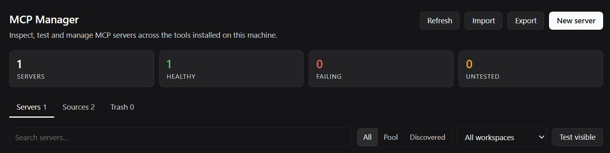

# MCP Manager

A DeepSeek Harness plugin that puts every MCP server definition on your machine in one place: it scans the
config files of the clients you already use, normalises them, verifies that each server actually answers the
MCP handshake, and keeps a small editable pool of its own.

Modelled on the idea of `dsh-skills-manager`, but for MCP servers instead of skills — and in English only.

Distributed as **`@zarpyk/dsh-mcp-manager`** (MIT). Source: <https://github.com/Zarpyk/dsh-mcp-manager>.



## What it does

- **Discovers** MCP servers from the config files of DeepSeek Harness, Claude Desktop / Claude Code, Cursor,
  VS Code, Windsurf, Codex, Zed, Gemini CLI, OpenCode, Cline, Roo Code, Kilo Code, Qwen, Trae and more, both
  user-level and per workspace.
- **Tests** any of them for real: it performs the MCP `initialize` handshake and lists the tools the server
  exposes, over stdio, streamable HTTP or legacy SSE. Failures come with a plain-English hint
  (missing executable, 401, DNS, certificate, timeout, unsupported protocol version).
- **Manages its own pool**: create, edit, enable/disable, soft-delete to trash, restore and export servers.
- **Exports** the pool as `mcpServers` JSON, VS Code `servers` JSON or Codex `config.toml`.
- **Imports** an existing config document by pasting it.
- **Never rewrites other applications' files.** Discovered entries are strictly read-only; the pool lives in
  the plugin's own state file.

It also registers five agent tools so the model can inspect and maintain the same inventory:
`mcp_inventory`, `mcp_probe`, `mcp_save_server`, `mcp_export_config`, `mcp_remove_server`.

## Where it shows up

Two entry points, both disabled independently if their slot is unavailable:

- **Settings → MCP Manager** – a page in the settings dialog, next to the built-in sections (order 26).
- **Sidebar panel** – a server-bars icon in the sidebar (order 3) that opens the same page in the central
  column. Pick it like any other panel; select another entry to leave.

The client half is a single plain-JS module (`lib/client.js`), so after changing it only a window reload is
needed — no rebuild step.

## Install

Published as **`@zarpyk/dsh-mcp-manager`**. From the profile that should load it:

```sh
dsh plugin --profile <profile> add @zarpyk/dsh-mcp-manager
```

or, from a checkout of this repository:

```sh
plugin_manager install_bundle  # target: this package directory
```

Using the Harness UI: Settings → Plugins → install from npm or from a local package directory.

Requirements: Node.js 20+ (the stdio probe spawns `node`-based servers) and a Harness build that provides
`@deepseek-ai/dsh-client-ui-slots` and `@deepseek-ai/dsh-client-locale` at `>=0.2.0-rc.1 <0.3.0-0`.

## Configuration

The bundle patch is intentionally empty apart from the insert row:

```yaml
- insert:
    - id: mcp-manager
      name: '@zarpyk/dsh-mcp-manager'
```

All behaviour is driven from the settings page; there is no required config.

## Files and storage

- State (pool + trash + last probe results): `$DSH_HOME/mcp-manager/state.json`
  (`%USERPROFILE%\.dsh\mcp-manager\state.json` on Windows by default).
- The file is written atomically (temporary file + rename) and is only touched by explicit actions.

## HTTP surface

The page talks to the host half over two routes, registered on the plugin's own connection:

| Method | Path | Purpose |
| --- | --- | --- |
| `GET` / `HEAD` | `/api/dsh-mcp-manager/state?workspace=` | Snapshot: servers, sources, trash, stats |
| `POST` | `/api/dsh-mcp-manager/action` | All mutations and probes |

Every `POST` must carry `x-dsh-mcp-manager: 1`, a JSON content type and a same-origin `Origin` header when one
is sent; anything else is rejected with `403` / `415`.

Actions: `refresh`, `probe`, `spec`, `save`, `set-enabled`, `delete`, `restore`, `purge`, `empty-trash`,
`import`, `export`.

Responses are `{ "ok": true, "data": … }` or `{ "ok": false, "error": "…", "code": "…" }`.

## Security notes

- Secrets in discovered configs are masked (`••••••` plus the last four characters) before they reach the
  browser, except through the explicit `spec` action used to pre-fill the editor.
- Cross-origin mutations are refused, and the custom header makes plain HTML form posts impossible.
- Probing a stdio server executes its configured command. That is the same trust model as running the server
  in its original client; only probe servers you would also run yourself.

## Development

```
lib/sources.js     where MCP configs live, per client
lib/parse.js       JSON/TOML config parsing, normalisation, masking
lib/probe.js       real MCP client (stdio, streamable HTTP, legacy SSE)
lib/state.js       pool state file
lib/discovery.js   file scanning and normalisation
lib/index.js       host half: HTTP routes, actions, agent tools
lib/client.js      web half: settings page (plain JS, no build step)
```

Tests use the Node test runner and need no dependencies:

```sh
node --test test/parse.test.js test/probe.test.js test/plugin.test.js test/client.test.js test/render.test.js
```

`test/render.test.js` renders the settings page with a tiny React substitute and a fixture snapshot, so the
whole tree (rows, details, tabs, editor) is exercised without a browser. The probe tests spawn a fake stdio
server and start throwaway HTTP servers on `127.0.0.1`; nothing touches your real config files (the plugin
tests point `HOME` and `DSH_HOME` at a temporary directory).

## Limitations

- It does not install servers into the Harness MCP Connector. That stays with the official connector plugin;
  use **Copy JSON** / **Export** to move definitions there.
- Project-level configs are only scanned for registered workspaces (plus explicit ones passed by the UI).
- TOML support covers the subsets MCP clients actually write (tables, arrays, inline tables, dotted keys),
  not the whole TOML 1.0 grammar.

## License

MIT.
